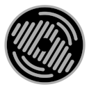
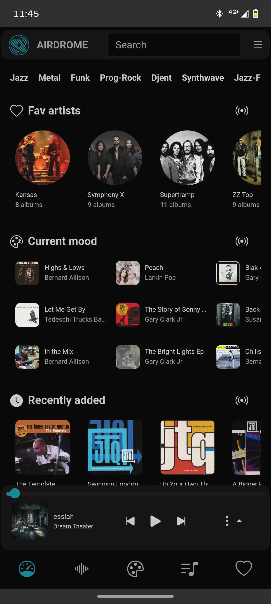
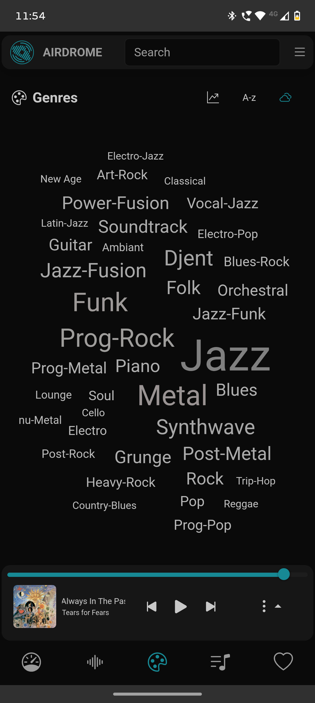
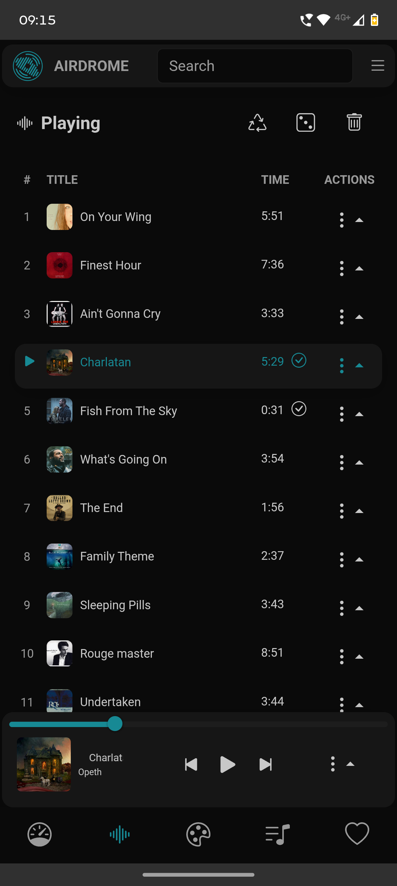
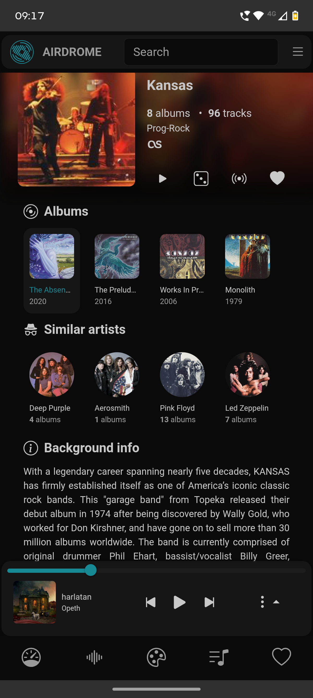
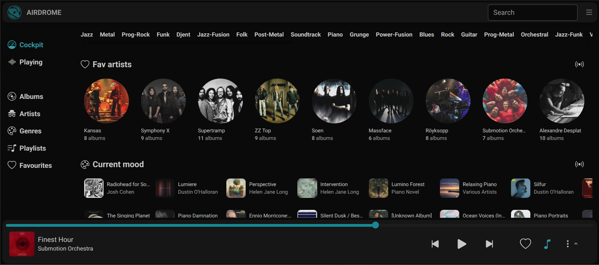

# Airdrome Music Player



Airdrome is a powerful modern application for Android and Desktop, supporting [navidrome](https://github.com/navidrome/navidrome), [airsonic-advanced](https://github.com/airsonic-advanced/airsonic-advanced), [NextCloud Music](https://apps.nextcloud.com/apps/music) and other [subsonic](https://github.com/topics/subsonic) compatible music servers.

Test the latest version here : [AIRDROME NIGHTLY](https://jpguillemin.github.io/Airdrome/)

## Features
- "Cockpit" library home page with playback suggestions based on recent listenings
- Library browsing for albums, artist, genres, playlists, favourites
- "Radio like" dynamic playlists for anything : Genre, Album, Artist, Recent albums, Favourites, Random
- 3 "CD quality" OPUS transcoding modes
- Native Gapless playback
- 2 modes Replay Gain support
- Full mediaSession integration
- Persistent queue, repeat, shuffle
- 4 color themes
- Responsive UI for Android, and WEB browser (standard page or PWA)
- Persistant cache and download for offline listening
- View, create, and edit playlists
- Full text search with sorted results by artists, albums, tracks
- Favourites tagging

## Screenshots

      



## Run from Docker Hub

```
$ docker run -d \
  --name=airdrome \
  --restart on-failure \
  --network=bridge \
  -p 8080:80 \
  h7p3ri0n/airdrome:latest

```

## Build your own Docker image

```
$ yarn install
$ yarn build
```

Bundle can be found in the `dist` folder.

Build docker image:

```
$ docker build -f docker/Dockerfile -t local/airdrome .

$ docker run -d \
  --name=airdrome \
  --restart on-failure \
  --network=bridge \
  -p 8080:80 \
  local/airdrome:latest

```

## Navidrome server requirements

Airdrome is only the client. It does not host or stream music by itself: it connects to a Subsonic-compatible server such as Navidrome.

Before using the hosted PWA or the Android APK, the Navidrome server must be reachable from the device:

- Navidrome must be installed, running, and serving the Subsonic API (default port: `4533`).
- A Navidrome user account with access to the music library is required.
- The server must be reachable from the client device. A hostname that only resolves on the local network is not enough for the hosted PWA.
- **HTTPS with a valid certificate is required** when using the hosted PWA. The app is served over HTTPS, so browsers block calls to `http://` servers (mixed content).
- A reverse proxy such as Nginx, Caddy, or Traefik is recommended in front of Navidrome.
- For a home server, a tunnel such as Cloudflare Tunnel or Tailscale Funnel is the simplest way to get a valid HTTPS URL.
- If you use Let's Encrypt, ports `80` and `443` must be reachable for certificate issuance and renewal.
- If the server stays on a private LAN, either expose it through a tunnel/reverse proxy or self-host Airdrome on the same network over HTTP.
- Self-signed certificates must be explicitly trusted by the device, otherwise the login will fail or fall back to an insecure URL.

In Airdrome, enter the server **base URL**, not a `/rest` endpoint:

```text
https://music.example.com
```

Do not use a private address such as `http://192.168.1.10:4533` from the hosted PWA: it is blocked by browser security rules.

## OpenSubsonic endpoints

- getAlbumList2
- getArtistInfo2
- getAlbumInfo2
- getStarred2
- search3
- getSongsByGenre
- getRandomSongs
- getPlayQueue
- savePlayQueue
- getScanStatus
- startScan
- getOpenSubsonicExtensions

## Contributors

- [chunjiw](https://github.com/chunjiw) — Capacitor-based Android build

## License

Licensed under the [AGPLv3](LICENSE) license.
