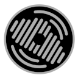
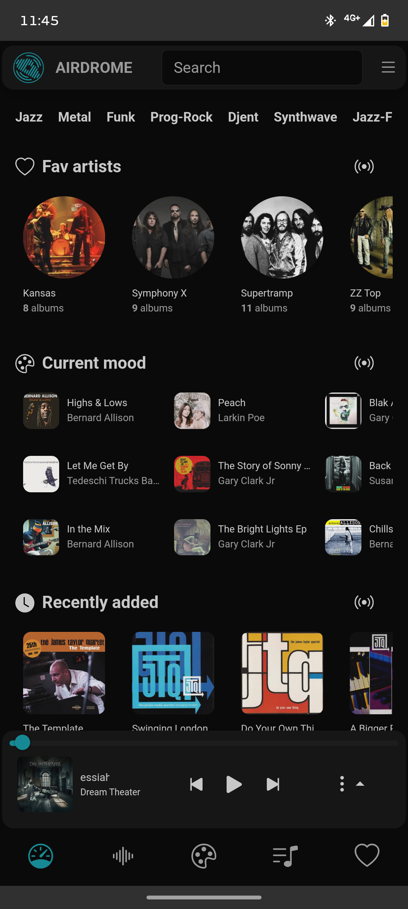
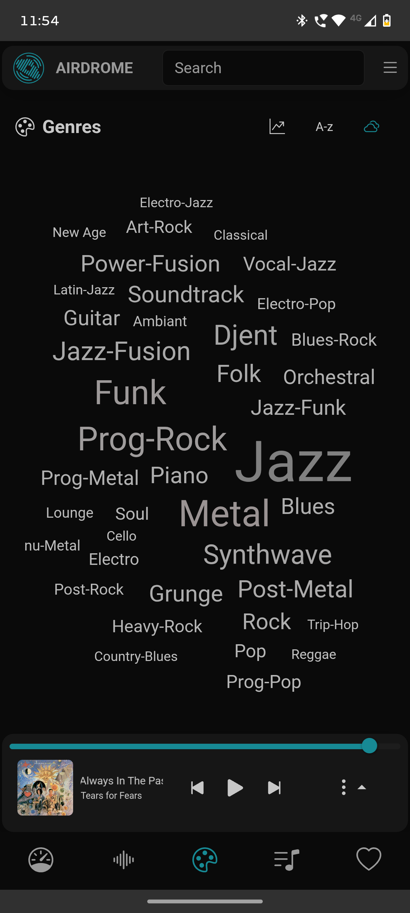
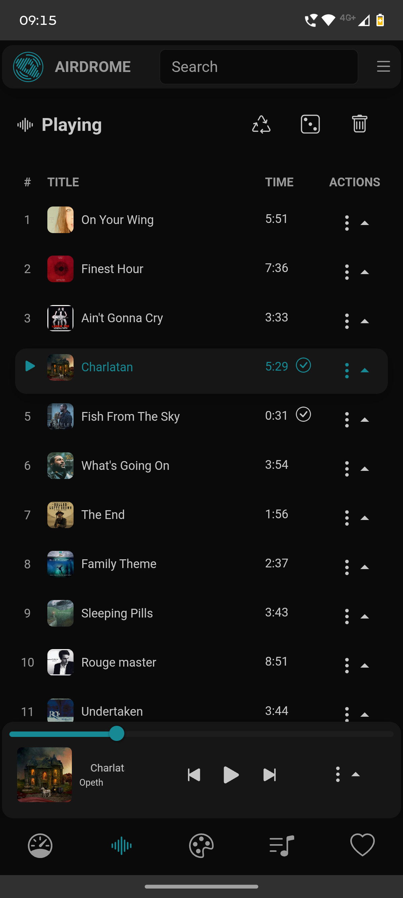
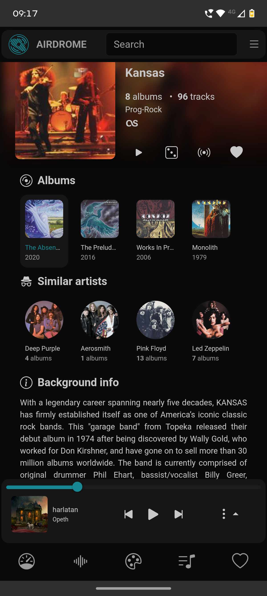
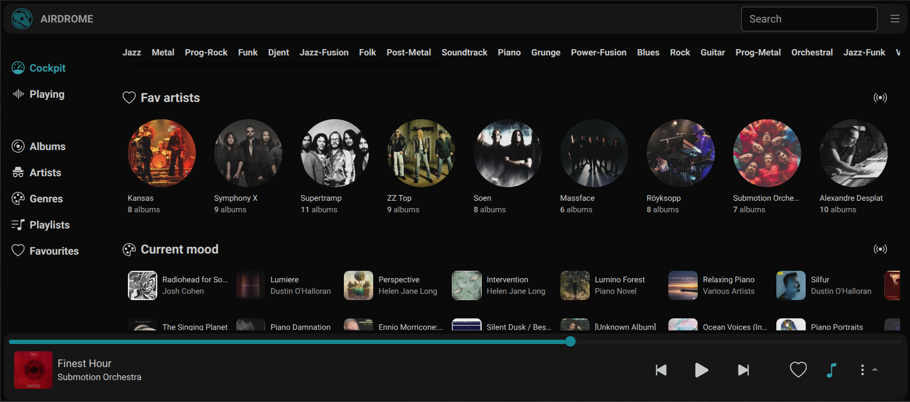

# Airdrome Music Player



Airdrome is a powerful modern application for Android and Desktop, supporting [navidrome](https://github.com/navidrome/navidrome), [airsonic-advanced](https://github.com/airsonic-advanced/airsonic-advanced), [NextCloud Music](https://apps.nextcloud.com/apps/music) and other [subsonic](https://github.com/topics/subsonic) compatible music servers.

Test the latest version here : [AIRDROME NIGHTLY](https://jpguillemin.github.io/Airdrome/)

## Features
- "Cockpit" library home page with playback suggestions based on recent listenings
- Library browsing for albums, artist, genres, playlists, favourites
- "Radio like" dynamic playlists for anything : Genre, Album, Artist, Recent albums, Favourites, Random
- 3 "CD quality" OPUS transcoding modes
- Native gapless playback for cached/offline tracks
- 2 modes Replay Gain support
- Full mediaSession integration
- Native Android playback with Media3 ExoPlayer, lock-screen / notification controls, audio focus and Bluetooth/headset routing
- Persistent queue, repeat, shuffle
- 4 color themes
- Responsive UI for Android, and WEB browser (standard page or PWA)
- Persistent native cache and download for offline listening
- View, create, and edit playlists
- Full text search with sorted results by artists, albums, tracks
- Favourites tagging

## Screenshots

      



## Run from Docker Hub

```
$ docker run -d \
  --name=airdrome \
  --restart on-failure \
  --network=bridge \
  -p 8080:80 \
  h7p3ri0n/airdrome:latest

```

## Build the web bundle

```
$ ./build.sh
```

Bundle can be found in the `dist` folder. This script never needs root.

## Build and run the local Docker container

```
$ ./build.sh
$ ./build-local-docker.sh
```

The first command builds the web bundle as your normal user (`build.sh` refuses
to run as root). The second builds the `local/airdrome:latest` image and runs
it on port 4321. It requires Docker access (root or the `docker` group) and can
be run as root. The Docker build context is generated from `docker.template/`.

To build and push the multi-arch public images, run `./build.sh` first, then
`./build-public-dockers.sh` (requires Docker buildx).

Manual equivalent:

```
$ docker build -f docker/Dockerfile -t local/airdrome .

$ docker run -d \
  --name=airdrome \
  --restart on-failure \
  --network=bridge \
  -p 8080:80 \
  local/airdrome:latest

```

## Android build (Capacitor)

The Android app is a Capacitor shell around the same web bundle. Playback is
handled by a native Media3 ExoPlayer plugin, with a native MediaSession for the
lock screen, notification, headset buttons, audio focus and Bluetooth/headset
routing. Offline audio and cover art use the Capacitor Filesystem plugin.

ExoPlayer preloads the next track only when it is already cached locally. This
keeps gapless playback for offline/cached music without opening a second remote
stream, which breaks servers that limit concurrent streams per user. Remote
tracks are loaded when the current one ends.

Airdrome's single-session mode pauses playback when another client writes the
same Navidrome play queue. If you intentionally use several clients with the
same account, turn off **Single session** in the top-right menu.

Requirements: Node.js 22+, JDK 21 and the Android SDK.

```bash
# Debug APK
npm run android:debug

# Release APK (falls back to the debug signing key when no keystore exists)
./build-apk.sh

# Open the native project in Android Studio
npm run cap:open
```

Build artifacts are written to `artifacts/airdrome-<version>.apk` (and `.aab`
when `BUILD_AAB=1`). They are kept out of `dist/` because `dist/` is copied
into the Android web assets by Capacitor.

`build-apk.sh` sets `JAVA_HOME`, `PATH`, `ANDROID_HOME` and
`ANDROID_SDK_ROOT` to local defaults, and loads signing values from
`.android-signing.env` when it exists. Copy the example once:

```bash
cp .android-signing.env.example .android-signing.env
# then edit the passwords in .android-signing.env
```

Release signing is optional. To sign with your own key, place
`android/app/airdrome-release.keystore` and fill in `STORE_PASSWORD`,
`KEY_PASSWORD` and `KEY_ALIAS` in `.android-signing.env` (or export them in
your shell). Without a keystore the release build falls back to the debug
signing key.

Create the keystore with the JDK’s `keytool`:

```bash
keytool -genkeypair -v \
  -keystore android/app/airdrome-release.keystore \
  -alias airdrome \
  -keyalg RSA -keysize 2048 -validity 10000 \
  -storepass 'your-store-password' \
  -keypass 'your-store-password' \
  -dname "CN=Airdrome, O=Airdrome, C=FR"
```

The `dist/` folder produced by `npm run build` is still the complete PWA; the
Capacitor build only adds the native wrapper and plugins on top of it.

### Native plugins

| Feature | Implementation |
| --- | --- |
| Audio playback / cached gapless / preload | custom Media3 ExoPlayer plugin (`android/.../ExoPlayerPlugin.java`) |
| Lock screen, notification, media keys | custom MediaSession plugin (`android/.../MediaSessionPlugin.java`) |
| Audio focus, headset / Bluetooth routing | custom MediaSession plugin |
| Offline audio and cover art | `@capacitor/filesystem` |
| Downloads | `@capacitor/filesystem` + `@capacitor/share` fallback |
| Connectivity | `@capacitor/network` |
| External links | `@capacitor/browser` |
| Android back button / app lifecycle | `@capacitor/app` |
| Haptics | `@capacitor/haptics` |
| Status bar / splash | `@capacitor/status-bar`, `@capacitor/splash-screen` |

## Connect Airdrome to Navidrome

Airdrome is only the client: you need a running Navidrome server.

The easiest way to make it reachable from the hosted PWA or the Android app is to expose it with [Cloudflare Tunnel](https://developers.cloudflare.com/cloudflare-one/connections/connect-networks/):

```bash
cloudflared tunnel --url http://localhost:4533
```

Cloudflare prints a URL like:

```text
https://random-name.trycloudflare.com
```

Enter that URL in Airdrome, then log in with your Navidrome username and password. That's it.

For a permanent address, create a named Cloudflare Tunnel and attach it to your own domain.

> Use an `https://` URL. The hosted PWA is served over HTTPS, so browsers block `http://` servers and private LAN addresses such as `http://192.168.1.10:4533`.

## OpenSubsonic endpoints

- createPlaylist
- deletePlaylist
- download
- getAlbum
- getAlbumInfo2
- getAlbumList2
- getArtist
- getArtistInfo2
- getArtists
- getCoverArt
- getGenres
- getOpenSubsonicExtensions
- getPlaylist
- getPlaylists
- getPlayQueue
- getRandomSongs
- getScanStatus
- getSongsByGenre
- getStarred2
- getTopSongs
- ping
- reportPlayback
- savePlayQueue
- scrobble
- search3
- star
- startScan
- stream
- unstar
- updatePlaylist

## Contributors

- [chunjiw](https://github.com/chunjiw) — Capacitor-based Android build

## License

Licensed under the [AGPLv3](LICENSE) license.
